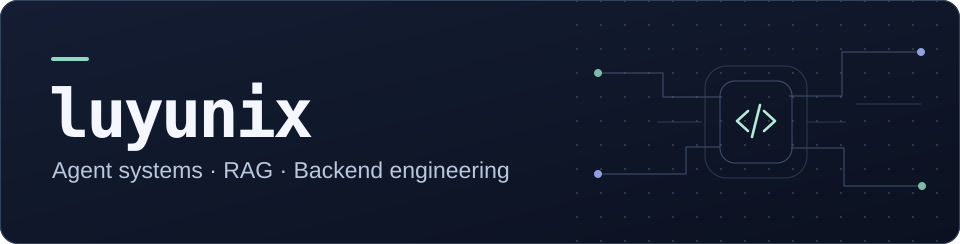

Hi, I'm Lucent, a backend and platform engineer working with Java and Python. I've worked at small, mid-sized, and large tech companies. My projects have included developer platforms for search, ads, and recommendation, search index pipelines, multi-version deployments, and platform redesigns. My recent work brings coding agents into developer workflows, using CLI tools and RAG to help engineers deploy changes, verify the results, and troubleshoot failures.

## Selected projects

**[Faber](https://github.com/luyunix/faber)** · AI Agent workbench with streaming sessions, tool activity, and a browser sandbox. [API](https://github.com/luyunix/api) · [UI](https://github.com/luyunix/ui) · [Sandbox](https://github.com/luyunix/sandbox)

**[Faber RAG](https://github.com/luyunix/faber-rag)** · Retrieval service with dense search, BM25, and rank fusion. Exposes MCP and FastAPI endpoints for AI clients and a management console.

**[PyFlightProfiler Helper](https://github.com/luyunix/PyFlightProfilerHelper)** · Java plugin for PyCharm that builds profiling commands from the Python code under the cursor.

**[Core Study](https://github.com/luyunix/core_study)** · Backend engineering notes with runnable examples and a searchable [reading site](https://luyunix.github.io/core_study/).

## Open-source work

| Project | Selected work |
| --- | --- |
| **AgentScope** | [Kubernetes workspace file handling](https://github.com/agentscope-ai/agentscope/pull/4226) · [Empty-document indexing errors](https://github.com/agentscope-ai/agentscope/pull/4266) · [Retryable Elasticsearch document deletion](https://github.com/agentscope-ai/agentscope/pull/4268) |
| **Hermes Agent** | [Preserve summary-model recovery across worker rebuilds](https://github.com/NousResearch/hermes-agent/pull/158934) |
| **LangGraph** | [Reproduced and reported a RemoteGraph bug for new threads](https://github.com/langchain-ai/langgraph/issues/9762) |
